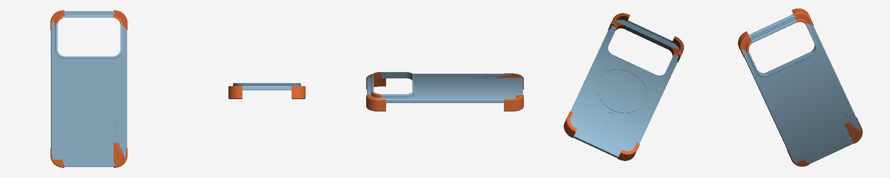

# iPhone 17 Pro Max exoskeleton case

Single-piece parametric "exoskeleton" case, generated by `generate_case.py`
(`pip install numpy trimesh manifold3d shapely matplotlib && python3 generate_case.py`).

Corners shown orange only for visual reference – the STL is one solid body.

**Output:** `stl/iphone17_promax_exoskeleton_case.stl` (one watertight body, 82.6 × 168.0 × 17.45 mm incl. camera rim)

- Size taken from the reference STL: footprint 82.6 × 168.0 mm, phone cavity 79 × 164 mm, 3 mm back plate.
- Flat back with only a low 1.2 mm lip between the corners – sides, buttons and ports stay open.
- Four full-height wrap-around corner bumpers (15 × 21 mm) with a 2 mm front lip that holds the phone.
- Large camera opening (67 × 41 mm) with a 3.5 mm raised rim.
- MagSafe ring + alignment pill grooves on the inside.
- Bold **SUMIT** debossed 1.2 mm into the back (8 mm text, reads bottom-to-top; `LOGO_TEXT` to change).

Print in TPU (back face down, supports for the corner lips) or flexible PETG. All sizes are constants at the
top of `generate_case.py`. The camera opening is estimated from the photos – check it against your phone.
